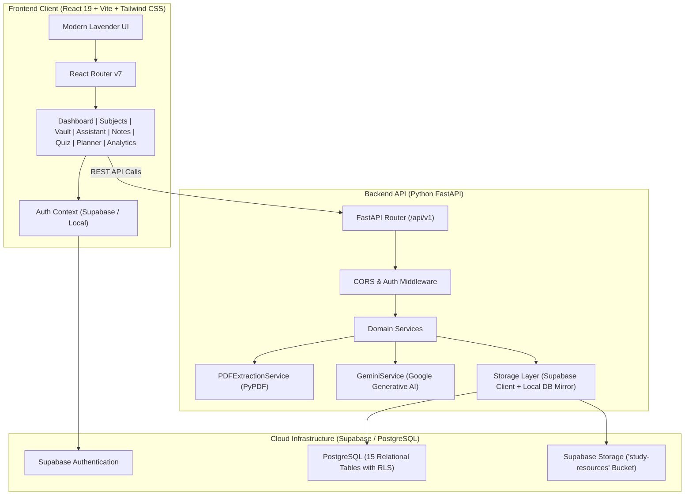

# StudyHub 1.0 — Architecture & System Design Document

**Project Title:** StudyHub 1.0 — AI-Based Study Resource Organizer  
**Course Level:** 2nd Year B.Tech Computer Science & Engineering Mini-Project  
**Evolution Path:** Future-proofed for 3rd-Year Minor Project (2.0) & 4th-Year Major Project (3.0)

---

## 1. System Architecture Overview

StudyHub 1.0 is engineered with a clean, decoupled, multi-tier micro-modular architecture:

---

## 2. Key Modules & Functional Separation

| Module | Location | Purpose |
| :--- | :--- | :--- |
| **Authentication** | `src/context/AuthContext.jsx` | Supabase Auth & protected routes; demo fallback mode. |
| **Student Dashboard** | `src/pages/DashboardOverview.jsx` | Welcome banner, quick actions, today's checklist, live stats. |
| **My Subjects** | `src/pages/SubjectsPage.jsx` | Semester courses, syllabus units, topic checklist, progress calculations. |
| **Resource Vault** | `src/pages/ResourcesPage.jsx` | Drag-and-drop file upload (PDF/DOCX/TXT), metadata tagging, text extraction. |
| **AI Study Assistant** | `src/pages/AIAssistantPage.jsx` | PDF-grounded Q&A using Gemini API, citation of document sections. |
| **AI Notes Generator**| `src/pages/AINotesPage.jsx` | Generates short revision notes, definitions, and 5/10 mark model answers. |
| **Quiz & Flashcards** | `src/pages/QuizFlashcardsPage.jsx` | Gemini MCQ generator with difficulty grading, instant scoring, interactive 3D flashcards. |
| **Study Planner** | `src/pages/StudyPlannerPage.jsx` | Prioritized tasks, assignment deadlines, exam countdown, weekly BTech schedule. |
| **Progress Tracker** | `src/pages/ProgressTrackerPage.jsx`| Recharts analytics calculated strictly from real database records. |
| **Settings** | `src/pages/SettingsPage.jsx` | Student profile management, Gemini and Supabase status monitors. |

---

## 3. Database Schema (15 Relational Tables)

1. `profiles`: Extends `auth.users` with student college, course, branch, and semester.
2. `subjects`: Core academic subjects with color branding and demo tags.
3. `units`: Syllabus units linked to subjects.
4. `topics`: Learning checklist items with completion states.
5. `resources`: File metadata, Supabase storage paths, and cached extracted text.
6. `resource_tags`: Taxonomies for fast filtering.
7. `generated_notes`: AI-generated markdown lecture notes and model answers.
8. `chat_sessions`: Grouped AI assistant consultations.
9. `chat_messages`: Contextual message history with grounding source markers.
10. `quizzes`: Generated assessments with difficulty and topic metadata.
11. `quiz_questions`: MCQs with 4 options, correct answer index, and explanations.
12. `quiz_attempts`: Student performance history with percentage scores.
13. `flashcards`: Active recall flashcards with question (front) and answer (back).
14. `study_tasks`: Scheduled tasks with dates, priorities, deadlines, and completion flags.
15. `study_sessions`: Chronological study time logging.

---

## 4. Multi-Year Roadmap

### StudyHub 1.0 (2nd Year Mini-Project - Current)
- Single-student resource organizer.
- PDF text extraction & Gemini 1.5 grounded Q&A.
- AI Notes Generator & MCQ test engine.
- Study planner and genuine database-driven progress analytics.

### StudyHub 2.0 (3rd Year Minor Project - Future)
- AI weakness detection from quiz score patterns.
- OCR for handwritten professor blackboard notes.
- Voice-based doubt solving.
- Personalized adaptive learning paths.

### StudyHub 3.0 (4th Year Major Project - Future)
- Virtual student study rooms & peer collaboration.
- Faculty grading portal & institutional LMS integration.
- Native mobile applications (React Native / Flutter).
